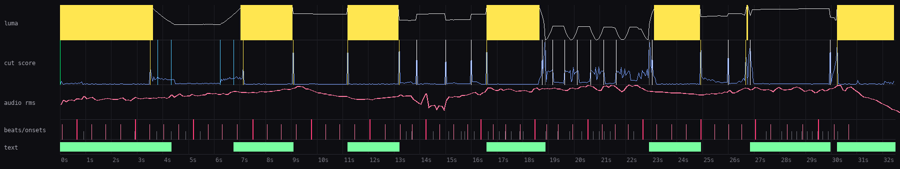
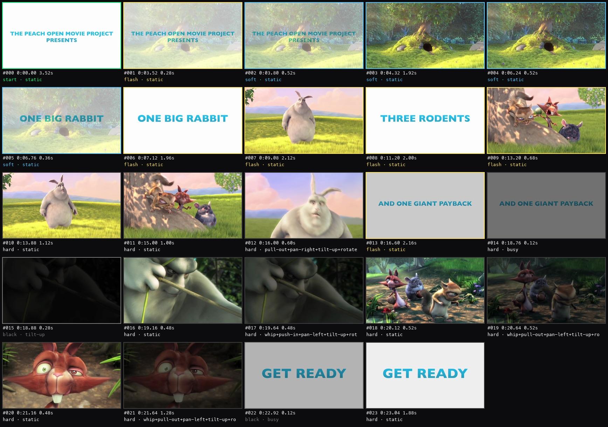

# reelscope

[](https://github.com/felixx-dbm/reelscope/actions/workflows/ci.yml)

Eyes for coding agents on video. `reelscope` turns a TikTok, Reel, YouTube clip or local file into things an LLM can read: a Markdown report, contact sheets of frames after every cut, a rhythm timeline, frame-by-frame strips and a cue map for [Remotion](https://www.remotion.dev).

It never plays audio or video. Everything is measured offline.

## The problem

Coding agents can build videos in Remotion, but they cannot watch a reference. "Make an edit like this TikTok" fails because the agent does not know where the cuts are, how fast the pacing is, whether cuts land on the beat, or what the white flash at 0:03 actually is. `reelscope` extracts that structure so the agent can copy the technique and then check its own render against the reference.

## Example

`reelscope analyze` on the [Big Buck Bunny](https://peach.blender.org) trailer (32 s):

```
30 shots, 53.6 cuts/min, avg 1.08 s, median 0.64 s. First cut at 3.52 s. Trend: accelerates.
Transitions: {'flash': 9, 'soft': 4, 'hard': 14, 'black': 2}
Style: fast cutting, white flash transitions, soft transitions, camera shake, whip pans, big title typography
107.7 BPM, -22.3 LUFS, 28% of cuts on a beat
```

Timeline (luma with flash regions, cut score, audio level, beats, on-screen text):



Contact sheet, one frame after every cut, labeled with timecode, shot length, transition type and camera motion:



<sub>Big Buck Bunny © Blender Foundation, [CC BY 3.0](https://creativecommons.org/licenses/by/3.0/).</sub>

## What it measures

- **Cuts and transitions**: shot detection with flash, black-frame and high-activity (burst) handling
- **Pacing**: cuts per minute, average shot length, first cut, speed-up/slow-down trend
- **Look**: brightness, contrast, saturation, warmth per shot
- **On-screen text**: OCR per shot with screen region (Apple Vision on macOS, Tesseract elsewhere), watermark separation
- **Audio**: tempo, beats, downbeats, onsets, drops, LUFS, true peak, and how many cuts land on a beat
- **Style fingerprint**: tags that summarize the edit for search and comparison

## Commands

| Goal | Command |
|---|---|
| Full analysis of a URL or file | `reelscope analyze <url\|file> -o runs/<name>` |
| Study a transition frame by frame | `reelscope frames <run> --at 3.2 --before 4 --after 8` |
| Remotion cue map in frames | `reelscope cues <run> --fps 30` |
| Reference vs. own render | `reelscope compare <ref-run> <own-run>` |
| Find similar videos or tutorials | `reelscope similar "<query>" -n 10 --analyze 3` |

Each run writes `report.md` (read this first), `sheet_XX.png`, `timeline.png`, `analysis.json`, `audio.wav` and the source video.

## Agent workflow

The [`skill/`](skill/SKILL.md) folder is a Claude Code skill that teaches an agent the loop:

1. Analyze the reference, read the report, look at the sheets and timeline.
2. Zoom into flashes and bursts with `frames` to see the actual technique.
3. Build in Remotion using `cues` for timing instead of guessing.
4. Render, analyze the render, `compare` it to the reference, fix the gaps.

Install it by copying `skill/` to `~/.claude/skills/reelscope/`.

## Install

Requirements: Python 3.11-3.13, `ffmpeg` on PATH. Optional: `tesseract` for OCR outside macOS.

```bash
uv tool install git+https://github.com/felixx-dbm/reelscope
reelscope analyze "https://www.tiktok.com/@user/video/123" -o runs/ref
```

Downloads go through `yt-dlp`, so anything it supports works.

## Development

```bash
uv run pytest
```

The test renders a synthetic three-shot clip with ffmpeg and checks that every cut is found on the exact frame.

## Stack

Python, OpenCV, librosa, pyloudnorm, NumPy/SciPy, Pillow, yt-dlp, Apple Vision (via `ocrmac`).

## License

MIT
